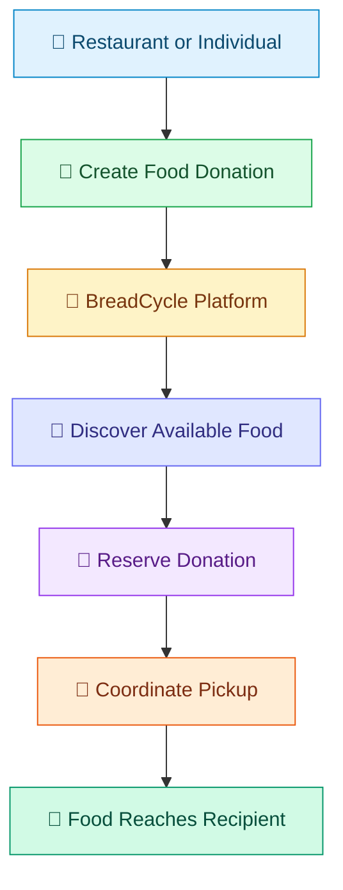

# 🍞 BreadCycle

### Rescue Food. Restore Hope. Reduce Waste.

<p align="center">
  
  
  
  
  
  
  
</p>

<p align="center">
  <strong>A food rescue and donation platform connecting surplus food with communities that need it.</strong>
</p>

<p align="center">
  <a href="https://bread-cycle.vercel.app">🌐 Live Demo</a> ·
  <a href="https://github.com/Chhavi-jain7/BreadCycle">📂 Repository</a>
</p>

---

## 🌍 The Problem

Every day, edible food is discarded while people in nearby communities struggle to access nutritious meals.

The challenge isn't always a lack of food. Sometimes, it's the lack of an efficient connection between those who have surplus food and those who need it.

**BreadCycle bridges that gap.**

It brings food donors, NGOs, recipients, volunteers, and administrators together through a centralized digital platform designed to make food redistribution easier and more organized.

> 💚 Food that might go to waste could become someone's next meal.

---

## ✨ Features

<table>
<tr>
<td width="50%" valign="top">

### 🥗 Food Donations
Create and manage surplus food donation listings to make available food easier to discover.

</td>
<td width="50%" valign="top">

### 🔎 Discover Food
Browse and search available donations to find suitable food options.

</td>
</tr>
<tr>
<td width="50%" valign="top">

### 🤝 Reservations
Reserve available donations and help coordinate their collection.

</td>
<td width="50%" valign="top">

### 🚚 Pickup Coordination
Support the organization and tracking of food collection and distribution.

</td>
</tr>
<tr>
<td width="50%" valign="top">

### 👥 Multiple User Types
Support donors, NGOs, recipients, volunteers, and administrators.

</td>
<td width="50%" valign="top">

### 🛡️ Admin Dashboard
Manage platform activities, users, donations, and related records.

</td>
</tr>
</table>

---

## 🔄 How It Works



---

## 🧰 Tech Stack

| Technology | Role |
|---|---|
| Next.js 14 | Frontend framework |
| React.js | User interface |
| JavaScript | Application logic |
| Node.js | Backend runtime |
| Express.js | REST API |
| Prisma ORM | Database access |
| Neon PostgreSQL | Hosted relational database |
| Vercel | Frontend deployment |
| Render | Backend deployment |
| Git & GitHub | Version control |

---

## 🏗️ Architecture

```text
                  ┌──────────────────────┐
                  │       Users          │
                  └──────────┬───────────┘
                             │
                             ▼
                  ┌──────────────────────┐
                  │   Next.js Frontend   │
                  │       Vercel         │
                  └──────────┬───────────┘
                             │ HTTPS / API
                             ▼
                  ┌──────────────────────┐
                  │    Express Backend   │
                  │       Render         │
                  └──────────┬───────────┘
                             │ Prisma ORM
                             ▼
                  ┌──────────────────────┐
                  │   Neon PostgreSQL    │
                  │   Hosted Database    │
                  └──────────────────────┘
```

---

## 🚀 Getting Started

Run BreadCycle locally by following these steps.

### Prerequisites

- [Node.js](https://nodejs.org/)
- npm
- Git

### 1. Clone the Repository

```bash
git clone https://github.com/Chhavi-jain7/BreadCycle.git
cd BreadCycle
```

### 2. Configure the Backend

```bash
cd backend
npm install
```

Create a `.env` file in the `backend` directory. Configure the database connection and other required environment variables.

Example:

```env
DATABASE_URL="your_database_connection_string"
PORT=5000
```

Replace the database placeholder with your own valid PostgreSQL connection string. Add any other variables required by the application.

Generate Prisma Client:

```bash
npx prisma generate
```

Apply the appropriate Prisma migrations or schema synchronization for your project before starting the backend. For production, use migrations rather than casually running schema-push commands against live data.

Start the backend:

```bash
npm start
```

### 3. Configure the Frontend

Open a second terminal:

```bash
cd frontend
npm install
```

Set the frontend's API URL to your running backend using the exact environment variable expected by your code.

For example, if your project uses `NEXT_PUBLIC_API_URL`:

```env
NEXT_PUBLIC_API_URL=http://localhost:5000
```

Start the development server:

```bash
npm run dev
```

Open **http://localhost:3000** in your browser.

> Environment variable names can differ by project. Follow the names already used in your codebase.

---

## ☁️ Deployment

BreadCycle uses a cloud-based deployment architecture.

| Service | Purpose |
|---|---|
| Vercel | Hosts the Next.js frontend |
| Render | Runs the Express backend |
| Neon | Provides the hosted PostgreSQL database |

### Deployment checklist

- [ ] Configure the frontend API URL.
- [ ] Configure backend environment variables.
- [ ] Connect the backend to Neon PostgreSQL.
- [ ] Apply the required database migrations.
- [ ] Configure CORS for the deployed frontend domain.
- [ ] Verify authentication and donation operations.
- [ ] Keep secrets out of GitHub.

### Live Application

**Frontend:** [Open BreadCycle](YOUR_VERCEL_URL)

**Backend:** Add your Render service URL here if you want to share the API endpoint.

*Replace the placeholder URLs with your actual deployment URLs before publishing this README.*

---

## 🔐 Security

- Keep `.env` files and database credentials private.
- Never commit API keys, passwords, or access tokens.
- Use secure password hashing and appropriate authentication controls.
- Restrict database access and configure production CORS correctly.
- Avoid placing secrets in frontend environment variables.
- Do not expose private user information in public repositories.

---

## 🌱 Vision & Future Enhancements

BreadCycle aims to make food redistribution more accessible and efficient.

Potential improvements include:

- 📍 Location-based discovery of donors and recipients.
- 🧠 Intelligent matching of donations with recipient needs.
- 🔔 Real-time pickup reminders and notifications.
- ⏳ Food freshness and expiration tracking.
- 📊 Analytics for verified donations and food rescued.
- 🗺️ Better coordination of collection routes.

These are future enhancements unless already implemented in the current version.

---

## 🤝 Contributing

Have an idea to improve food rescue?

1. Fork the repository.
2. Create a feature branch.
3. Implement your changes.
4. Commit and push your work.
5. Open a pull request with a clear description.

Contributions that make food redistribution safer, simpler, and more accessible are welcome.

---

## 💚 Our Mission

We believe technology should solve real problems and bring communities closer together.

BreadCycle transforms surplus food into an opportunity to help others by connecting donors, recipients, and volunteers through technology.

<p align="center">
  <strong>🍞 Good food deserves a good destination.</strong>
  <br/>
  <em>Rescue Food. Restore Hope. Build a Better Tomorrow.</em>
</p>

<p align="center">
  Made with 💚 for a world with less food waste.
</p>

<p align="center">
  <a href="https://github.com/Chhavi-jain7/BreadCycle">⭐ Explore BreadCycle on GitHub</a>
</p>
